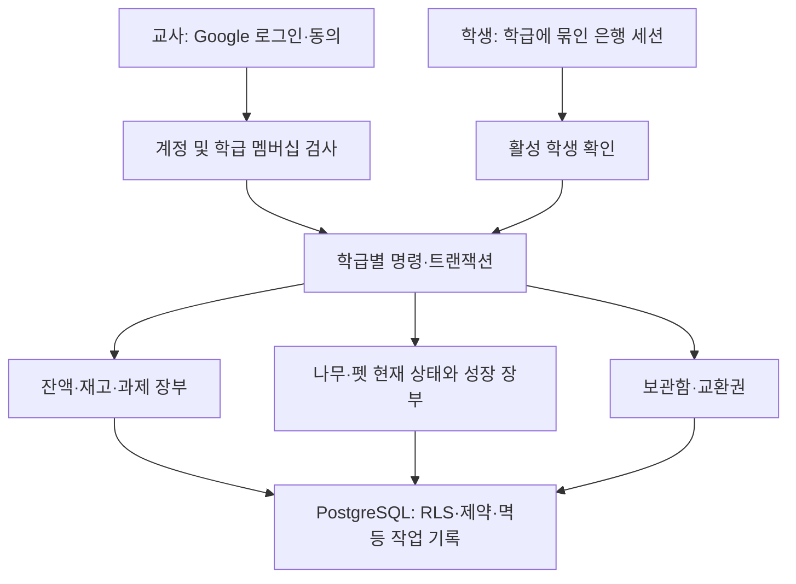

# CRS 시스템 변경·보안·성능 심층 검토

작성일: 2026-10-11 · 상태: **조사 및 보고 완료, 제품 패치·배포 없음**

## 판단과 우선순위

Claude Code가 추가한 교사 계정, 학급 나무, 보관함·교환권, 펫 기능을 현재 배포 소스와 대조하고, 실제 코드로 격리 재현을 진행했다. **먼저 고쳐야 할 문제는 ① 화면에 보이는 계정과 다른 계정이 탈퇴되는 현상, ② 응답이 끊긴 교환권 결제를 재시도했을 때 생기는 중복 결제다.** 둘 다 특별한 공격 도구 없이 정상적인 계정 변경이나 통신 장애로 발생한다.

학급 권한 확인, 학생 세션에서의 본인 식별, DB의 행 단위 접근 제한 등 기본 방어는 조사 범위에서 유지된다. 그러나 개별 API의 권한 검사만으로는 계정 변경·탈퇴·결제 재시도처럼 여러 단계가 연결되는 오류를 막지 못했다. 기존 테스트가 통과해도 이 경로들은 추가 검증이 필요하다.

아래 11건을 조치 대상으로 분류했다. 모두 같은 의미의 “해킹 취약점”은 아니다. 보안·개인정보, 금액 정합성, 동시 처리, 설정에 따른 보상 정책, 성능, 화면 정합성을 구분했다. P1은 우선 수정 대상, P2는 후속 수정 대상으로 사용하며 CVSS 점수는 부여하지 않았다.

| ID | 우선순위 | 분류 | 확인한 문제 | 확인 수준 |
| --- | --- | --- | --- | --- |
| AUTH-01 | **P1** | 계정·파괴적 작업 | B 계정 화면에서 탈퇴했는데 남아 있던 A 계정의 학급이 폐쇄됨 | 실제 콜백·쿠키·탈퇴 SQL 재현 |
| INPUT-01 | **P1** | 결제 정합성 | 교환권 결제의 응답 유실 후 ‘다시 시도’가 새 결제가 됨 | 실제 매점 UI·결제 SQL 재현 |
| AUTH-02 | P2 | 세션 수명 | 탈퇴 전 Google 세션으로 재가입 후의 새 학급까지 접근 가능 | 실제 쿠키·권한·탈퇴 SQL 재현 |
| AUTH-03 | P2 | 개인정보 보유 | 탈퇴 후에도 거래·과제 기록의 학생 이름 사본이 남음 | 합성 데이터로 탈퇴 전후 대조 |
| AUTH-04 | P2 | 동의 절차 | 기존 로그인 세션은 필수 동의 없이 학급 API 사용 가능 | 실제 학급 생성·권한 검사 재현 |
| INPUT-02 | P2 | 결제 오류 처리 | 교환권 조회 실패를 ‘없음’으로 간주하여 정상가 결제 | 실제 UI·결제 SQL 재현 |
| INPUT-03 | P2·조건부 | 자원 사용 | 디지털 상품 수량만큼 SQL을 반복하며 실용적인 수량 상한이 없음 | 소량 쿼리 수 측정 + 코드 확인 |
| PET-01 | P2 | 동시 처리 | 교사 성장 조정과 학생 돌봄의 잠금 순서가 반대라 교착 가능 | 네이티브 PostgreSQL 동시 실행 재현 |
| PET-02 | P2·조건부 | 보상 정책 | 목표가 낮으면 무료 돌봄·졸업 보상을 같은 날 반복 수령 가능 | 허용되는 설정으로 실제 명령 재현 |
| PERF-GROWTH-01 | P2 | 조회 성능 | 나무 기여도 조회가 기존 취소 인덱스를 사용하지 못함 | 네이티브 PostgreSQL 실행 계획 비교 |
| UI-01 | P2 | 화면 정합성 | 늦게 도착한 조회 응답이 이미 갱신된 잔액을 과거 값으로 덮음 | 실제 은행 UI 재현 |

운영 데이터를 변경하거나 실제 계정 탈퇴·결제·부하 공격을 실행하지 않았다. 아래 재현의 이름·학생·잔액·거래는 모두 격리 환경의 합성 데이터다.

## 조사 대상과 현재 배포의 일치

| 항목 | 확인 결과 |
| --- | --- |
| 운영 진입점 | <https://crs.hwanit.com/classes> |
| 종전 도메인 | `crs-postgresql.vercel.app`에서 새 도메인으로 308 이동, 경로·쿼리 유지 |
| 운영 계정·프로젝트 | haeon0511의 Vercel `crs-postgresql`, 현재 haeon0511 Neon |
| 현재 배포 | `dpl_Fxszz1yiRNvdXWPmPsSSVq9LK96o`, READY, sin1 |
| 조사 커밋 | `818fbac5863b243ed50ba54a969d7c311c5ccb2a` |
| 비교 기준 | 10월 7일 최적화 완료 커밋 `91443a61b720398299643d0f7a7bfa3e665ca076` |
| 이후 변화량 | 6개 커밋, 191개 파일, 18,032줄 추가·1,217줄 삭제 |
| 배포 소스 대조 | 소스·공개 자산·패키지·설정 등 **719개 파일 모두** 현재 저장소 바이트와 Vercel 배포 소스 SHA-1 일치 |
| DB | 운영 서버가 반환한 버전 PostgreSQL 18.6; 스키마·권한·함수·인덱스만 읽기 전용으로 확인 |
| 조사 중 제품 변경 | 소스·운영 DB·배포·계정 설정 변경 없음; 보고서와 진행 기록만 작성 |

대조는 Vercel 프로젝트의 현재 운영 대상과 두 도메인의 연결을 확인한 뒤 수행했다. 로컬에 남은 배포 후보의 동일 719개 파일도 일치한다. 단순히 “로컬 최신 코드일 것”이라고 가정한 결과가 아니다. 다만 719개 비교는 배포 **입력 파일**에 대한 것으로 생성된 실행 바이너리 전체의 재현 빌드 검증을 의미하지 않는다.

근거: 로컬 비공개 증거 폴더 `/home/haeon/.cache/crs-audit-20261011`의 `remote-source-comparison.json`, `retained-source-comparison.json`, `project-metadata.json`, `database-metadata.json`, `growth-metadata.json`. 비밀값과 학생 원본 데이터는 보고서에 포함하지 않았다.

## Claude Code 변경 사항과 현재 구조

10월 7일 이후의 변경은 화면 꾸미기에 한정되지 않는다. 교사 계정의 수명 관리와 학생 보상의 종류가 추가되어 인증·장부·결제의 연결 지점이 늘어났다.

| 영역 | 현재 구현 | 검토상 의미 |
| --- | --- | --- |
| 교사 계정 | 약관·개인정보 동의, 재동의, 닉네임·아이콘, 탈퇴. 마이그레이션 0043 | Google 세션과 동의 대기 세션, DB 계정·학급 소유권을 함께 관리해야 함 |
| 관리자 인증 | PostgreSQL 모드에서 예전 비밀번호·관리자 QR 로그인을 종료하고 Google 학급 멤버십 사용 | 기존 관리자 쿠키만으로 권한을 얻는 호환 경로가 제거됨 |
| 도메인·공유 | 대표 도메인, 관리자·매점·은행 링크 공유, QR/이미지/PDF, 학부모 동의서, QR 카메라 처리 개선 | 공유 URL과 로그인 권한을 구분해야 함; 새 관리자 QR에 인증 비밀을 싣지 않음 |
| 학급 나무 | 물주기·과제·햇빛·교사 조정, 성장 기록, 수확 및 보상. 0044·0047·0049·0050 | 학급 전체가 공유하는 성장 행의 동시 변경과 보상 원자성이 중요 |
| 학생 보관함 | 소비형·소장형 디지털 물품, 지급·사용·회수, 구매 물품, 교환권. 0045·0046 | 결제·교환권 소비·재고·보관함을 같은 거래로 처리해야 함 |
| 펫 | 입양·돌봄·부화·졸업, 교사 성장 목표, 동행·장식·방, 교사 성장 조정. 0048·0049·0050 | 학생별 성장 상태와 영구 이력이 분리되고 과제 보상에도 연결됨 |
| 최신 정책 | 과제 먹이·물방울은 수동 돌봄의 일일 한도를 사용하지 않음. 영업 시간 밖 놀아주기 표시 및 잠듦 표시 조정 | 초기 구현·주석보다 10월 11일 최종 동작을 기준으로 검토 |

예를 들어 0050 SQL의 초기 주석은 과제 성장을 일일 한도에 포함한다고 적혀 있으나, 이후 `83402b5`의 코드·테스트가 이를 제외하도록 바꿨다. 이번 검토에서는 최신 정책을 의도된 동작으로 취급했다.

현재 주요 데이터 흐름은 다음과 같다.



성장은 현재 상태 행과 수정 불가 이력을 함께 쓴다. 학급당 자라는 나무 하나, 학생당 기르는 펫 하나는 유일 인덱스로 제한한다. 과제 지급·취소에서 나무와 펫 훅을 실행하며, 수확·졸업에서 화폐와 선택적 물품 보상도 같은 DB 트랜잭션에 넣는다. 이 방향은 정합성에 유리하지만, 인증 주체 선택·재시도 요청 보존·잠금 순서까지 일관되어야 한다.

## 우선 조치 1: 계정·동의·탈퇴

### AUTH-01 — 화면과 다른 계정을 탈퇴할 수 있음

**발생 조건:** 한 브라우저에서 기존 학급을 가진 A 계정이 재동의 화면에 도달해 동의 대기 쿠키를 받은 뒤, 그 쿠키의 30분 수명 안에 이미 동의를 마친 B 계정으로 로그인한다. 이어 B의 프로필에서 탈퇴를 확인한다.

프로필은 B의 Google 세션을 읽지만, 탈퇴 API의 `readAccountIdentity`는 동의 대기 쿠키 A를 무조건 우선한다. B 로그인 성공 시 A의 대기 쿠키를 지우지 않기 때문이다. 실제 콜백·암호화 쿠키·탈퇴 함수 재현에서 **탈퇴 응답은 200, A 학급 접근은 403, B 학급 접근은 계속 200**이었다. 사용자가 본 계정과 파괴적 작업의 대상이 다르다.

같은 원인으로 일반 로그아웃도 대기 쿠키를 남겨, 동의 API를 통해 새 Google 로그인 없이 다시 세션을 만들 수 있었다. 임의의 다른 사람 계정을 지정하거나 쿠키 암호화를 깨는 공격은 확인하지 않았다. 두 계정 모두 해당 브라우저에서 실제로 로그인한 이력이 있어야 한다.

위치: [accountRequest.ts](../../src/server/accountRequest.ts) 18–23행, [Google 콜백](../../src/app/api/google/callback/route.ts) 59–80행, [프로필](../../src/app/profile/page.tsx) 22–36행, [탈퇴 API](../../src/app/api/account/withdraw/route.ts) 20–25행, [로그아웃](../../src/server/adminLogout.ts) 20–26행.

**권고:** 일반 로그인 성공과 모든 로그아웃에서 대기 신원을 폐기하고, 동의·탈퇴가 사용할 신원을 화면의 확인 대상과 명시적으로 결합한다. 두 신원이 동시에 있으면서 다르면 조용히 한쪽을 우선하지 말고 다시 확인하도록 한다. 쿠키 삭제만 추가하는 것으로 끝내지 말고, A→B 계정 전환과 로그아웃 후 대기 동의 재사용을 회귀 검사에 넣는다.

### AUTH-02 — 탈퇴 전 Google 세션이 재가입 후에도 유효함

탈퇴 함수는 예전 `tenant_sessions`를 폐기하고 멤버십·동의를 삭제한다. 그러나 현재 Google 로그인은 최대 30일짜리 자체 완결형 쿠키이며, DB에 계정 세대나 세션 폐기 시점을 대조하지 않는다. 탈퇴 응답에서 해당 브라우저 쿠키를 지워도 다른 기기 또는 보관된 기존 쿠키는 무효화되지 않는다.

실제 재현에서 탈퇴 전 쿠키는 원래 폐쇄된 학급의 권한 검사에는 403을 받았다. 하지만 같은 쿠키로 새 학급을 만들면 201, 새 학급의 실제 관리자 권한 검사를 연결한 최소 테스트 핸들러에서는 200이었다. 재동의·재가입으로 만든 학급도 Google subject가 같아 기존 쿠키로 권한 검사를 통과했으며, 다시 탈퇴하여 새 학급들을 폐쇄할 수도 있었다. **원래 폐쇄 학급의 접근 차단은 작동하지만, 탈퇴가 로그인 권한의 수명을 끝내지는 못한다.**

위치: [0043 탈퇴 SQL](../../src/server/db/migrations/0043_teacher_accounts.sql) 160–176행, [googleOAuth.ts](../../src/server/googleOAuth.ts) 244–250·495–499행, [tenantAuth.ts](../../src/server/tenantAuth.ts) 42–50행.

**권고:** 서버가 관리하는 로그인 세대·세션 ID·폐기 시점을 도입하고 탈퇴와 원자적으로 무효화한다. 교사 API와 대기 동의 경로 모두 이를 확인해야 한다. 재가입에는 새 Google 인증이 필요하며, 폐기된 신원으로 동의 API를 호출해 세션의 발급 시각을 갱신할 수 없어야 한다. 서버 측 세션 무효화의 필요성은 [OWASP 세션 관리 지침](https://cheatsheetseries.owasp.org/cheatsheets/Session_Management_Cheat_Sheet.html)과도 일치한다.

### AUTH-03 — 탈퇴 시 학생 이름 삭제 설명과 실제 보유 데이터가 다름

탈퇴는 `students.name`을 삭제 표기로 바꾸지만, `transactions.student_name_snapshot`과 `task_completions.student_name_snapshot`에는 원래 학생 이름이 남는다. 현재 개인정보처리방침 48행은 보호된 장부에 학생 이름 없이 번호와 금액만 남는다고 설명하므로 구현과 직접 충돌한다.

합성 학생의 거래·과제 이력을 만든 뒤 실제 탈퇴를 실행하여 세 필드를 대조했다. 학생 기본 행은 바뀌었고 두 장부 사본의 이름은 그대로였다. 폐쇄 학급 접근은 403이므로 **외부 공개나 실제 유출을 확인한 것은 아니다.** 작업 결과 JSON 등 추가 사본도 정리 대상 목록에 포함해야 한다.

위치: [0043 탈퇴 SQL](../../src/server/db/migrations/0043_teacher_accounts.sql) 133–134·156–160행, [개인정보처리방침](../../src/app/privacy/page.tsx) 48행, [초기 운영 스키마](../../src/server/db/migrations/0002_operational.sql) 235–236·389–390행, [과제 지급](../../src/server/repositories/database/taskLedger/reward.ts) 77–106행.

**권고:** 장부 정합성을 유지하면서 식별 정보 사본을 지우는 관리자용 절차 또는 식별 정보 분리 설계를 마련한다. 거래·과제 스냅샷, 작업 결과, 이전 원본 보관 자료까지 목록화하고 실제 삭제 검증을 붙인다. 그 전에는 사용자에게 제공하는 보유·삭제 설명을 사실에 맞춰야 한다.

`account_withdrawals.residual_purged_at`은 있으나 저장소에서 잔여 자료 파기 실행기나 완료 표시 갱신 구현은 발견하지 못했다. 30일 이내 파기 약속을 수행할 운영 절차와 증거가 필요하다. 이번 조사는 실제 탈퇴자나 만료 기한을 조회하지 않았으므로 **30일 기한 위반 또는 법률 위반으로 단정하지 않는다.**

### AUTH-04 — 필수 동의가 공통 서버 권한 조건이 아님

새 Google 로그인 콜백과 가입 화면에는 동의 검사가 있지만, 이미 유효한 Google 쿠키를 가진 교사의 학급 생성·관리 API는 현재 동의를 확인하지 않는다. 약관 기능 도입 이전 쿠키 또는 향후 약관 개정 전 쿠키가 해당한다.

동의 정보가 없는 실제 암호화 세션으로 학급 생성 201, 관리자 권한 검사 200을 재현했다. 반면 동의 대기 쿠키만 있으면 401, 다른 Google 계정으로 해당 학급에 접근하면 403이었다. 다른 교사의 학급을 탈취하는 문제와 구별되는 **필수 동의 절차의 서버 적용 누락**이다.

위치: [teacherAccounts.ts](../../src/server/teacherAccounts.ts) 109–115행, [classMutationRequest.ts](../../src/server/classMutationRequest.ts) 29–38행, [tenantAuth.ts](../../src/server/tenantAuth.ts) 42–50행. 프로필 저장 API만 별도로 동의를 확인한다.

**권고:** 계정 세대 확인과 현재 동의 검사를 공통 서버 관문에 모은다. 동의·탈퇴·로그아웃 등 필요한 예외만 명시하고, 학급 생성·관리·관리자 API에 적용한다. UI 안내는 유지하되 권한 조건의 유일한 근거로 쓰지 않는다. [OWASP 권한 검사 지침](https://cheatsheetseries.owasp.org/cheatsheets/Authorization_Cheat_Sheet.html)은 모든 요청에서 일관된 검사를 권고한다.

## 우선 조치 2: 교환권 결제와 보관함

### INPUT-01 — 성공 응답이 유실되면 재시도가 중복 결제가 됨

서버의 동일 작업 ID 재처리 방지는 작동한다. 문제는 UI가 불확실한 결제를 재시도하면서 교환권을 다시 조회하고 요청 내용 및 작업 ID를 바꾸는 데 있다.

실제 `KioskApp`과 결제 명령을 연결한 격리 재현 결과:

| 단계 | 결과 |
| --- | --- |
| 시작 | 잔액 5,000, 재고 20, 300짜리 상품 2개, 교환권 1장 |
| 첫 결제 | 교환권을 써서 300 차감, 재고 2 차감, 서버 처리 성공 |
| 통신 장애 | 서버 성공 응답만 인위적으로 유실시킴 |
| 화면의 ‘다시 시도’ 후 동일 학생 확인 | 이미 소비된 교환권이 조회되지 않아 교환권 없는 요청과 새 작업 ID 생성 |
| 두 번째 결제 | 600 추가 차감, 재고 2 추가 차감 |
| 최종 DB | **잔액 4,100, 재고 16, CHECKOUT 거래 2건** |

위치: [KioskApp.tsx](../../src/components/KioskApp.tsx) 507–511행의 재시도, 363–374행의 재조회, 519–530행의 요청 지문·작업 ID 생성.

**권고:** 결과가 불명확한 동안 최초 요청의 작업 ID, 가격 조건, 교환권 목록을 그대로 보관한다. 재시도는 그 요청을 먼저 재전송·확인해야 하며, 교환권 재조회로 새 결제를 만들면 안 된다. ‘서버는 성공했지만 응답만 유실된 경우’를 교환권까지 포함해 회귀 검사한다.

### INPUT-02 — 교환권 조회 실패가 정상가 결제로 이어짐

`fetchCheckoutVouchers`는 실패를 구분해서 반환하지만 호출부는 `ok`가 아니면 빈 목록으로 바꾼다. 따라서 적용 가능한 교환권이 있어도 일시적 500·네트워크 오류 등이 생기면 교환권 선택 없이 정상가 결제를 진행한다.

실제 UI 재현에서 교환권 조회에만 합성 500을 반환했다. DB에는 사용 가능한 교환권이 있었지만 600 전액이 결제되고 교환권은 미사용으로 남았다.

위치: [KioskApp.tsx](../../src/components/KioskApp.tsx) 365–374행, [bagClient.ts](../../src/components/bag/bagClient.ts) 39–58행.

**권고:** 조회 실패에서는 결제를 멈추고 조회 재시도를 제공한다. 정상가 결제를 허용하려면 금액을 보여주고 명시적으로 선택하게 한다. 성공한 빈 목록과 실패를 분리한다. INPUT-01과 같은 화면이지만 발생 조건과 수정 지점은 다르다.

### INPUT-03 — 디지털 상품 수량이 SQL 실행 횟수로 확대됨

신규 `giveStoreDigitalItems`는 구매 단위마다 `INSERT`를 하나씩 기다린다. 이 루프가 잔액·상품 행 잠금을 가진 결제 트랜잭션 안에 있다. 결제 수량은 양의 안전한 정수로만 제한되며 디지털 물품 총개수에 대한 실용적인 한도가 없다.

소량 합성 구매에서 수량 1개는 `tx.execute` 15회, 24개는 38회였다. 23개 증가에 쿼리도 정확히 23회 늘었다. 큰 재고를 설정한 디지털 상품을 살 수 있는 잔액이 있거나 무료 상품인 경우, 작은 요청 본문의 숫자 하나가 많은 DB 작업으로 확대될 수 있다.

위치: [studentBag.ts](../../src/server/repositories/database/studentBag.ts) 153–160행, [결제 API](../../src/app/api/checkout/route.ts) 117–125행, [checkoutCommands.ts](../../src/server/repositories/database/checkoutCommands.ts) 169–190·281–286행.

**권고:** 정규화한 전체 결제의 디지털 단위 수에 현실적인 상한을 먼저 적용하고, 허용한 물품은 크기가 제한된 묶음 삽입으로 처리한다. 결정적 물품 ID, 재고·잔액 검사, 전체 원자성을 유지한다. 요청 바이트 제한만으로는 숫자 확대를 막지 못한다. 대량 요청이나 운영 부하 시험은 실행하지 않았으므로 운영 장애 발생 또는 수용 용량을 주장하지 않는다.

## 우선 조치 3: 성장 기능의 동시성·보상·조회

### PET-01 — 교사 성장 조정과 학생 돌봄이 교착할 수 있음

일반 돌봄은 `학생/계좌 → 펫` 순서로 잠근다. 교사 성장 조정은 먼저 펫을 잠근 뒤 `pet_growth`를 삽입한다. 이 삽입의 학생 외래키 확인이 학생 행 잠금을 요구하여 반대 순서가 된다.

```text
교사 조정: 펫 잠금 확보 → 성장 기록 INSERT → 학생 행 잠금 대기
학생 돌봄: 학생/계좌 잠금 확보 → 같은 펫 잠금 대기
```

실제 명령을 네이티브 PostgreSQL에서 동시에 실행하고 위 잠금 지점의 순서만 제어했다. 한 요청은 `40P01`로 중단되고 다른 요청은 완료됐다. 트랜잭션 실행기는 `40001`만 재시도하므로 API 오류 매핑상 일반 500 응답으로 이어진다. 이 재현에서 HTTP 요청까지 실행한 것은 아니다. 롤백 덕분에 금액·성장 상태 손상은 확인되지 않았다.

위치: [pets.ts](../../src/server/repositories/database/pets.ts) 850–858행, 일반 잠금 159–164·223–226·528–529행, [0048 외래키](../../src/server/db/migrations/0048_pets.sql) 102행, [transaction.ts](../../src/server/db/transaction.ts) 71–82행.

**권고:** 학생/계좌를 먼저 잠그고 펫을 다시 읽어 소유권·상태를 검사하는 공통 순서를 적용한다. `40P01`의 제한적 재시도는 보완책으로 검토하되 순서 교정을 대체하지 않는다. 교사 조정↔돌봄, 교사 조정↔과제 지급의 실제 동시 세션 회귀 검사가 필요하다. 잠금 순서와 교착 해소 동작은 [PostgreSQL 공식 잠금 문서](https://www.postgresql.org/docs/current/explicit-locking.html)에 설명되어 있다.

### PET-02 — 낮은 목표 설정에서 무료 졸업 보상을 반복 수령함

무료 WARM 돌봄 한도는 학생이 아닌 `펫 ID + 날짜`에 묶인다. 졸업하면 새 펫을 즉시 입양할 수 있다. 따라서 목표가 1회의 무료 성장량 이하이고 졸업 보상이 양수인 설정에서는 같은 날 입양→무료 돌봄→졸업을 반복할 수 있다.

서버가 허용하는 `goal=1`, `careGrowth=1`, `feedDailyLimit=0`, `rewardAmount=100`에서 실제 명령으로 세 번 반복했다. 같은 한국 날짜에 잔액은 100→200→300→400으로 증가했고, 각 펫의 일일 돌봄 표시는 1회였다. 직접 성장 값을 조작하지 않았다.

위치: [pets.ts](../../src/server/repositories/database/pets.ts) 540–547행의 한도, 497–505·589–620행의 입양·졸업, [pet.ts](../../src/domain/pet.ts) 194–202행의 설정 범위.

**조건과 해석:** 기본값인 목표 40·돌봄 성장 1에서는 이 한 번 돌봄 반복이 성립하지 않는다. 교사가 설정을 바꿔야 하므로 무조건 발생하는 보안 침해로 분류하지 않았다. 무제한 반복 졸업이 의도된 정책이라면 명시적인 안내가 필요하다.

**권고:** 학생별 무료 돌봄·졸업 보상 상한을 둘지 정한 뒤 계좌 잠금 안에서 검사한다. 더 작은 변경으로는 한 번의 무료 돌봄으로 유상 보상 졸업이 가능한 설정에 제한·명시적 경고를 둘 수 있다. 같은 작업 ID의 중복 방지만으로는 서로 다른 입양·졸업 반복을 막을 수 없다.

### PERF-GROWTH-01 — 나무 기여도에서 불필요한 거래 이력 스캔

나무 관리자 화면은 취소 여부 확인을 위해 `transactions`를 연결하면서 `kind='CANCELLATION'`을 명시하지 않는다. 현재 운영 DB에 있는 `transactions_cancellation_lookup_idx`는 이 조건이 붙은 부분 인덱스이므로 기존 SQL에는 적용되지 않는다.

위치: [classTree.ts](../../src/server/repositories/database/classTree.ts) 299–313행, [0039 인덱스](../../src/server/db/migrations/0039_transaction_history_indexes.sql) 2–4행.

현재 나무 기록 1개, 학생 2명, 거래 5,004건 중 관련 없는 과거 기록 5,000건을 둔 격리 DB에서 실제 쿼리를 비교했다.

| 지표 | 현재 SQL | 취소 종류 조건을 명시한 비교 SQL |
| --- | --- | --- |
| 거래 접근 | 순차 스캔 5,004행 | 기존 취소 인덱스, 해당 취소 0행 |
| 해당 노드 shared-hit 블록 | 107 | 2 |
| 단일 로컬 실행 | 2.690ms | 0.213ms |

**권고:** 조인에 취소 종류 조건을 추가해 기존 인덱스를 활용한다. 추가 마이그레이션 없이 개선 가능한 지점이다. 취소·미취소 WATER/TASK 기여 결과가 동일한지 검사하고, 실제 런타임 RLS 조건에서도 실행 계획을 확인한다. 위 시간은 한 번의 로컬 합성 측정이므로 운영 속도가 특정 배수로 빨라진다는 뜻은 아니다. 확실한 근거는 불필요한 이력 스캔의 제거다.

### UI-01 — 늦은 조회가 최신 은행 잔액을 덮어씀

은행의 `loadTree`와 `loadPet`은 로그인 세대만 확인한 뒤 응답의 잔액으로 공통 프로필을 갱신한다. 같은 로그인 중 과제 지급이 완료되어도, 먼저 시작된 조회를 무효화할 변경 세대나 데이터 버전은 없다.

실제 `BankApp` 재현에서 최초 나무 조회 응답을 지연시켰다. 과제 지급 완료 후 성공 화면과 홈 잔액은 1,205였으나, 이후 과거 나무 응답 1,200을 전달하자 홈 잔액이 1,200으로 돌아갔다. **DB 잔액이 줄어든 것은 아니고 화면의 최신성 문제다.** 펫 조회에도 같은 덮어쓰기 구조가 있다.

위치: [BankApp.tsx](../../src/components/BankApp.tsx) 140–170행, 220–233행, 247–260행.

**권고:** 데이터 변경 세대 또는 서버 상태 버전으로 이전 요청을 배제한다. 잔액을 갱신할 책임을 모으고, 성공한 쓰기 이후에는 관련 조회를 무효화·다시 조회한다. 금액은 정상적으로 감소할 수도 있으므로 두 잔액 중 큰 값만 고르는 방식은 쓰면 안 된다.

## 추가 최적화 후보

다음은 코드와 쿼리 구조에서 확인한 개선 후보다. 앞의 확정 재현 항목과 달리 현재 운영의 느림이나 처리량 저하를 수치로 입증한 것은 아니다.

| 후보 | 근거 | 권고와 측정 기준 |
| --- | --- | --- |
| 펫 현재 화면과 누적 도감 분리 | [pets.ts](../../src/server/repositories/database/pets.ts) 420행은 학생의 전체 FEED 이력에서 최신 시각을 집계하고, 429–431행은 졸업한 펫을 모두 반환 | 현재 방·기르는 펫은 작게 조회하고 도감은 필요할 때 페이지로 가져오기. FEED 최신 조회용 부분 인덱스를 검토하고 누적 이력별 읽은 행·응답 바이트 측정 |
| 비활성 기능·반복 설정 조회 축소 | [classTree.ts](../../src/server/repositories/database/classTree.ts) 212–223행, [pets.ts](../../src/server/repositories/database/pets.ts) 328–339행. 설치되었으나 꺼진 두 기능도 존재·설정 확인 4쿼리 추가 | 한 트랜잭션 안에서 설정·기능 존재 결과 재사용, 교사 일괄 지급의 반복 읽기 감소. 계정·학급이 섞이는 전역 캐시는 피하기 |
| 과제 지급의 공유 잠금 구간 단축 | 두 성장 훅이 활성 상태에서 각각 순차 SQL을 추가하며, 현재 나무 하나를 모든 학생이 공유 | 안전한 읽기를 묶고 설정 조회를 재사용한 뒤, 나무 잠금 보유 시간과 대기 시간을 여러 학생 동시 지급에서 측정. 정확한 성장 합산 없이 `FOR UPDATE`를 제거하지 않기 |
| 은행 상세 화면 지연 로딩 | [BankApp.tsx](../../src/components/BankApp.tsx) 33–34행이 나무·펫 전체 화면을 정적 import하며 렌더링·방·스프라이트 코드가 연결됨 | 홈 요약 카드는 작게 유지하고 상세 화면만 동적 import. 변경 전후 은행 초기 JS·휴대기기 파싱·첫 조작 시간을 측정. 이번에는 빌드 바이트 절감량을 측정하지 않음 |
| 겹치는 조회와 잔액 응답 정리 | 은행 진입에서 과제·나무·펫·가방을 병렬 요청, 새로고침은 프로필까지 5개. 여러 응답이 공통 잔액을 덮음 | UI-01 해결과 함께 잔액의 버전·조회 책임 정리. 필요하면 작고 일관된 홈 요약 API 검토. 무조건 큰 통합 API를 만들지는 않기 |
| 작은 본문 한도의 실제 적용 시점 | [accountRequest.ts](../../src/server/accountRequest.ts) 41–42행 및 나무·펫 HTTP helper가 본문을 다 읽은 뒤 길이 검사 | 기존의 제한된 스트림 읽기 도구 재사용. 인증·호스팅 측 제한을 고려해야 하므로 이 관찰만으로 무제한 메모리 공격이 가능하다고 판단하지 않음 |

관리자 펫·나무 패널은 이미 동적 로딩하며 상시 폴링하지 않는다. 펫 화면의 5초 타이머는 브라우저 내부 상태 저장으로 서버 쓰기가 아니다. 영업 시간이 활성화된 펫 화면의 분 단위 새로고침과 구분했다. 이미 개선된 부분을 다시 문제로 계산하지 않았다.

## 유지되는 방어와 정책상 제외한 항목

운영 DB에서 신규 15개 테이블의 RLS 및 FORCE RLS, 현재 앱 역할의 `NOSUPERUSER`·`NOBYPASSRLS`를 확인했다. 교사 동의·프로필·탈퇴 기록은 앱 역할에 직접 CRUD 권한이 없고 의도된 함수로만 접근한다. 조사한 SECURITY DEFINER 함수는 고정 `pg_catalog` 검색 경로를 사용하며 PUBLIC 실행 권한이 없었다. `student_items`에는 필요한 열별 수정 권한이 있으므로 테이블 전체 UPDATE 권한이 없다는 사실을 기능 고장으로 오해하지 않았다. RLS의 적용 범위와 소유자·우회 역할 차이는 [PostgreSQL 공식 RLS 문서](https://www.postgresql.org/docs/current/ddl-rowsecurity.html)를 기준으로 확인했다.

코드·기존 테스트·격리 확인에서는 다음 방어가 유지됐다.

- 다른 Google subject로 관리 요청을 보내면 403, 동의 대기 쿠키만으로 관리자 API에 접근하면 401이다.
- 학생 은행의 나무·펫·보관함은 요청 본문이 아닌 학급에 묶인 학생 세션에서 학생을 결정한다.
- 교환권은 학급·소유 학생·미사용·미회수 조건을 검사하고 잠근다. 서버가 가격을 다시 계산하며, 같은 작업 ID 재전송은 소비된 교환권 확인 전에 원래 결과를 돌려준다.
- 결제·잔액·재고·물품 지급·교환권 소비는 한 트랜잭션이다. 일반 취소는 사용된 구매 물품을 검사하고, 미사용 구매 물품 회수와 교환권 복원을 수행한다.
- 새 공유 기능에서 임의 URL을 서버가 가져오거나 사용자 문자열을 실행 가능한 HTML로 넣는 경로는 발견하지 못했다. 관리자 공유 링크에는 로그인 권한이 필요하다.
- 현재 Vercel 미리보기·배포 URL 보호 설정을 읽었고 추가 검증 우회 키는 0개였다. 공개 도메인의 일반 보안 응답 헤더도 확인했다.
- 운영 의존성 `npm audit --omit=dev --json`의 **현재 보고 취약점은 0건**이다. 이는 앱 로직 결함, 미공개 취약점, 개발 의존성까지 없다는 뜻은 아니다.

기존에 사용자가 보류한 **매점 학생 번호·이름·잔액 공개 정책**은 이번 신규 조치 목록에 넣지 않았다. 공개 디지털 상품 목록의 정상 200 응답도 권한 우회로 분류하지 않았다.

별도 정책 확인 대상은 성장 보상 취소다. 현재 GROWTH_REWARD 취소는 화폐를 되돌리지만 졸업·수확 이력과 관련 물품을 그대로 남길 수 있다. 성숙한 나무·펫 이력을 유지한다는 구현 의도가 있으므로 명확한 제품 약속 없이 결함이라고 단정하지 않았다. “화폐 취소”인지 “보상 전체 회수”인지 문서와 화면에서 일치시킬 필요가 있다. 기존의 거래 취소 시 음수 잔액 허용은 승인된 정책으로 유지했다.

## 검증 내역과 한계

| 확인 | 결과 | 해석 |
| --- | --- | --- |
| 인증 관련 기존 검사 | 8파일·67개 통과 | 기존 정상·거부 경로 |
| 보관함·결제·공유 관련 기존 검사 | 8파일·125개 통과 | 기본 소유권·금액·UI 처리 |
| 라우트 권한·목록·은행·도메인·QR 기존 검사 | 7파일·177개 통과 | 위 그룹과 checkout·QR 일부 중복; 합산 총계로 표시하지 않음 |
| 인증 신규 재현 | 5개 통과 | 위 문제가 실제로 재현된다는 뜻 |
| 매점·보관함 신규 재현·계측 | 3개 통과 | 응답 유실·조회 실패·단위별 SQL 수 |
| 네이티브 PostgreSQL 신규 재현 | 3개 통과 | 잠금 충돌·반복 보상·실행 계획 |
| 은행 지연 응답 신규 재현 | 1개 통과 | 확인된 최신 잔액이 과거 값으로 덮임 |
| 운영 HTTP | 비로그인 GET 14개 | 화면·리다이렉트·권한 거부·헤더. 계정 profile GET 405는 지원하지 않는 메서드이며 인증 성공이 아님 |
| 운영 DB | 읽기 전용 메타데이터 확인 | 실제 학생·거래 행 미조회, BEGIN READ ONLY 후 ROLLBACK |
| 운영 소스 | 719개 파일 일치 | 현재 배포에 관련되는 분석임을 확인 |

신규 재현 12개가 통과했다는 것은 **서비스가 모두 정상이라는 뜻이 아니라 각 결함·조건부 현상을 재현하는 검사에 성공했다는 뜻**이다. 최종 재현이 끝난 뒤 제품 파일은 그대로다.

인증 재현은 0001–0050 전체 마이그레이션과 제한된 런타임 권한을 설치한 PGlite에서 실제 쿠키·라우트·SQL을 실행했다. Google 코드 교환과 운영 연결을 대체했으며, 관리자 접근의 200/403은 실제 디스패처·권한 검사에 최소 보호 핸들러를 연결해 검증했다. 모든 관리자 업무 API를 실행한 것은 아니고, 학급 생성·탈퇴는 실제 핸들러와 SQL을 실행했다. 매점은 실제 React UI와 실제 결제·보관함 명령을 격리 PGlite에 연결했다. 은행의 늦은 응답은 실제 UI에서 응답 순서를 제어했다. 따라서 실제 Google 브라우저 로그인 전체나 운영 모바일 기기 결과를 새로 검증한 것은 아니다.

교착·보상 반복·조회 계획은 외부 네트워크 없는 임시 PostgreSQL 17 컨테이너에서 실행했다. 운영은 PostgreSQL 18.6이므로 운영 처리량·지연의 동일성을 주장하지 않는다. 교착 검사는 실제 명령과 제한된 앱 권한을 사용했고, 실행 계획 비교는 명시적 학급 조건이 있는 격리 소유자 연결에서 얻었다. 성능 수정 시 실제 런타임 RLS 계획 검증을 추가해야 한다.

이번에는 전체 저장소 회귀 검사, 운영 부하 시험, 실제 계정 탈퇴, 실제 학생 결제, 휴대기기 카메라·렌더링 시험을 수행하지 않았다. 이전 작업 기록의 대규모 검사 수와 시간 초과 재검사 주장을 이번 통과 수로 가져오지 않았다. 생략·미완료 항목을 통과로 계산하지 않는다.

## 수정 순서와 완료 판정 기준

1. **AUTH-01 + INPUT-01:** 대상 계정과 불확실한 결제 요청을 보존하는 불변 조건부터 보강한다. 두 계정 교체·로그아웃·성공 후 응답 유실을 실제 UI/쿠키/DB 조합으로 검사한다.
2. **AUTH-02 + AUTH-04:** 세션 폐기·현재 동의 확인을 공통 서버 계층으로 통합한다. 탈퇴 전 모든 기기의 쿠키가 재가입 후에도 거부되는지 확인한다. 전 계정·전 기능의 오래된 세션을 다룰 배포 정책도 마련한다.
3. **AUTH-03 + INPUT-02:** 개인정보 설명과 실제 파기 범위를 맞추고, 교환권 조회 오류에서 결제를 멈춘다. 파기는 보호된 장부 설계를 고려한 별도 DB 변경·검증이 필요하다.
4. **PET-01 + UI-01:** 잠금 순서와 응답 순서를 교정한다. 실제 동시 세션 시험과 지연된 이전 응답 시험을 릴리스 검사에 포함한다.
5. **INPUT-03 + PET-02:** 단위 수 상한·묶음 삽입을 적용하고, 무료 성장·졸업의 학생별 제한 정책을 정한다. 기본값과 극단적 허용 설정 모두 검사한다.
6. **PERF-GROWTH-01 이후 구조 최적화:** 기존 인덱스를 사용하는 작은 변경부터 시작해 펫 이력·설정 재조회·공유 잠금·은행 초기 로딩을 측정하면서 개선한다.

변경량이 큰 만큼 수정 후에는 관련 회귀 검사 외에 출시 후보를 고정한 전체 검사와 스키마 호환성 검토를 거쳐야 한다. 현재 DB에는 새 성장 거래 종류와 장부가 있으므로 **10월 7일 이전/초기 배포로 단순 되돌리는 것은 안전한 복구 방법이 아니다.** 현재 데이터를 이해하는 코드로 전진 수정하거나 검증된 호환 후보를 준비해야 한다.

## 재현 자료와 인계

제품 저장소에는 이 보고서만 추가했다. 진행 상태는 기존 단일 기록 `class-store-supervision/codex-development-20261005.json`에 합쳤으며, 테스트 장치와 상세 결과는 `/home/haeon/.cache/crs-audit-20261011`에 보관했다.

| 자료 | 위치 |
| --- | --- |
| 전체 감사 인덱스 | `audit-summary.json` |
| 인증 분석·재현 | `auth/auth-findings.json`, `auth/reproduction-results.json`, `auth/auth-lifecycle.test.ts` |
| 결제·교환권 분석·재현 | `input/findings.json`, `input/voucher-retry-evidence.json`, `input/voucher-retry.test.tsx` |
| 디지털 물품 쿼리 수 | `input/digital-query-count-evidence.json` |
| 성장·동시성·실행 계획 | `performance/findings.json`, `performance/probe-results.json`, `performance/probe.test.ts` |
| 은행 지연 응답 | `bank-stale-balance.json`, `bank-stale.test.tsx`, `bank-stale.log` |
| 기존 검사 | `auth/existing-results.json`, `input/existing-tests.json`, `targeted-regression.log` |
| 배포·DB·HTTP·의존성 | `remote-source-comparison.json`, `database-metadata.json`, `growth-metadata.json`, `public-http.json`, `npm-audit-production.json` |

보고서 작성 시점에는 수정·커밋·푸시·재배포를 수행하지 않았다. A–F의 과거 수용 이력을 이번 기능 전체의 새 검증 완료로 덮어쓰지 않았다.
